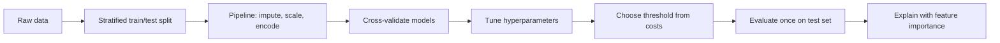

# Machine Learning Fundamentals with scikit-learn

A hands-on walk through the core of applied machine learning, built one runnable script at a time. Every concept is demonstrated with code, measured with real output, and explained in terms of the decision it supports.

The running example is **customer churn prediction**: given a customer's tenure, bill, contract and support history, estimate how likely they are to leave.


## Highlights

- **17 self-contained scripts** covering the path from a first model to a tuned, evaluated pipeline.
- **Leak-free by design.** All preprocessing lives inside a scikit-learn `Pipeline`, so imputation, scaling and encoding are learned from training folds only.
- **Evaluated honestly.** Models are compared with stratified 5-fold cross-validation. The test set is used once.
- **Metrics chosen for the business problem.** On a dataset where 19.5% of customers churn, accuracy is shown to be misleading and is replaced by recall, precision and ROC-AUC.
- **Reproducible.** Fixed random seeds and a pinned `requirements.txt` mean every number below can be regenerated.

## Key findings

| Finding | Evidence |
| --- | --- |
| Accuracy hides failure on imbalanced data | Logistic regression scores 82.5% accuracy but catches only 23 of 78 churners. Predicting "nobody churns" already scores 80.5%. |
| Model complexity must be tuned, not maximized | A decision tree's test ROC-AUC peaks at depth 3 (0.782) and collapses to 0.560 with unlimited depth, while its training score reaches 1.000. |
| One split is not enough | Five cross-validation folds of the same model range from 0.736 to 0.845 (mean 0.790, std 0.035). |
| The decision threshold is a business lever | Lowering the cutoff from 0.5 to 0.2 raises recall from 0.295 to 0.782 with no retraining. |
| Class weights shift the cutoff, they do not add skill | `class_weight="balanced"` lifts recall to 0.782 while ROC-AUC barely moves (0.803 to 0.805). |
| A simple baseline can win | Logistic regression (ROC-AUC 0.803) beats untuned Random Forest (0.768) and Gradient Boosting (0.765) on this data. |
| Feature importance methods can disagree | Impurity importance ranks `monthly_charges` second (0.309). Permutation importance shows it barely matters (0.018) and puts `contract` first. |

## The workflow



## Stages

### 00. Basics: a first model

`00_basics/01_first_model.py`

Trains a decision tree on 8 hand-typed customers and predicts 2 new ones. The pattern is visible by eye, which makes it clear what "learning from examples" means before any real data is involved.

### 01. Core concepts

| Script | What it demonstrates |
| --- | --- |
| `01_features_labels_split.py` | Separating features (`X`) from the label (`y`) and making a stratified 80/20 split that keeps the churn rate at 19.5% in both parts |
| `02_overfitting_depth.py` | Overfitting and underfitting, shown by sweeping tree depth and comparing train and test scores |
| `03_cross_validation.py` | Stratified 5-fold cross-validation and why a mean with a standard deviation beats a single score |

The bias and variance tradeoff in one table:

| Tree depth | Train ROC-AUC | Test ROC-AUC | Diagnosis |
| --- | --- | --- | --- |
| 1 | 0.656 | 0.688 | Underfit (high bias) |
| 3 | 0.773 | 0.782 | Best generalization |
| 8 | 0.930 | 0.731 | Overfit |
| No limit | 1.000 | 0.560 | Memorized the training set (high variance) |

### 02. Supervised and unsupervised learning

| Script | Task | Dataset | Result |
| --- | --- | --- | --- |
| `01_classification.py` | Classification | Churn | Hard labels vs probabilities with `predict` and `predict_proba` |
| `02_regression.py` | Regression | Diabetes (442 rows) | MAE 42.8, RMSE 53.9, R squared 0.453 |
| `03_kmeans.py` | Clustering | Iris (150 rows) | Elbow in inertia near k = 3, silhouette prefers k = 2 |
| `04_pca.py` | Dimensionality reduction | Breast cancer (30 features) | 2 components keep 63.2% of the variance, 10 keep 95% |

Takeaway: clustering metrics can disagree, so choosing k is a judgment call. PCA compresses well only because the original features are correlated.

### 03. scikit-learn tooling

| Script | What it demonstrates |
| --- | --- |
| `01_pipeline.py` | A `ColumnTransformer` that imputes and scales numeric columns and one-hot encodes categorical ones, chained with a model in a single `Pipeline` |
| `02_grid_search.py` | `GridSearchCV` over 8 hyperparameter combinations with 5 folds each (40 fits) |

Grid search result: best parameters `C=0.1` and `class_weight="balanced"`, cross-validated ROC-AUC 0.791, test ROC-AUC 0.807. The closeness of the two scores indicates the validation estimate was reliable.

### 04. Classification algorithms and metrics

| Script | What it demonstrates |
| --- | --- |
| `01_compare_models.py` | Logistic Regression, Random Forest and Gradient Boosting on the same pipeline and split |
| `02_confusion_matrix.py` | Confusion matrix, precision, recall and F1 |
| `03_threshold.py` | The precision and recall tradeoff across decision thresholds |
| `04_class_imbalance.py` | The effect of class weighting on an imbalanced target |

Model comparison on the test set (400 customers, 78 churners):

| Model | Accuracy | Precision | Recall | F1 | ROC-AUC |
| --- | --- | --- | --- | --- | --- |
| Logistic Regression | 0.825 | 0.605 | 0.295 | 0.397 | 0.803 |
| Random Forest | 0.785 | 0.375 | 0.154 | 0.218 | 0.768 |
| Gradient Boosting | 0.797 | 0.459 | 0.218 | 0.296 | 0.765 |

Threshold tuning for logistic regression:

| Threshold | Churners caught (of 78) | False alarms | Precision | Recall |
| --- | --- | --- | --- | --- |
| 0.5 | 23 | 15 | 0.605 | 0.295 |
| 0.3 | 47 | 59 | 0.443 | 0.603 |
| 0.2 | 61 | 95 | 0.391 | 0.782 |

Takeaway: a missed churner costs far more than an unnecessary retention call, so this problem favors recall. The threshold should be set from those costs, not left at 0.5.

### 05. Decision trees

| Script | What it demonstrates |
| --- | --- |
| `01_tree.py` | A depth-2 tree printed as readable rules |
| `02_pruning.py` | Cost complexity pruning with `ccp_alpha` |
| `03_feature_importance.py` | Impurity importance vs permutation importance |

The depth-2 tree recovers the main story in two questions: month-to-month customers with short tenure churn at 42.7%, while long-tenure customers on longer contracts churn at 5.3%.

Pruning result:

| `ccp_alpha` | Leaves | Train accuracy | Test accuracy |
| --- | --- | --- | --- |
| 0 (unpruned) | 372 | 1.000 | 0.730 |
| 0.002 | 12 | 0.822 | 0.800 |

Cutting the tree from 372 leaves to 12 raised test accuracy by 7 points and closed the gap between train and test.

## About the data

Stages 01, 03, 04 and 05 use a **synthetic** churn dataset of 2,000 customers generated by `make_churn.py`. Churn is drawn from a known formula with random noise, and 5% of monthly charges are removed to simulate missing values.

Using synthetic data is deliberate: because the true drivers of churn are known, it is possible to check whether each method recovers them. Permutation importance does (contract and tenure rank first), which is how the weakness of impurity importance was exposed.

Stage 02 uses datasets bundled with scikit-learn (diabetes, iris, breast cancer).

## Project structure

```
ml-fundamentals/
  README.md
  requirements.txt
  make_churn.py                  # generates the practice dataset
  common.py                      # shared split and preprocessing
  00_basics/
  01_ml_concepts/
  02_supervised_unsupervised/
  03_sklearn_tooling/
  04_classification/
  05_decision_trees/
```

## Run it yourself

```bash
git clone https://github.com/<your-username>/ml-fundamentals.git
cd ml-fundamentals
python3 -m venv .venv
source .venv/bin/activate          # Windows: .venv\Scripts\activate
pip install -r requirements.txt
```

Run any script from the project root as a module:

```bash
python3 -m 01_ml_concepts.02_overfitting_depth
python3 -m 04_classification.03_threshold
```

The `-m` form is required so that scripts inside the stage folders can import `common.py` and `make_churn.py` from the root.

## Tech stack

Python, scikit-learn, pandas, NumPy

## What I would do next

- Apply the same workflow to a real churn dataset as an end-to-end capstone project.
- Tune the tree ensembles with `RandomizedSearchCV`, since they were compared here with near-default settings.
- Serve the saved pipeline behind a FastAPI prediction endpoint with input validation and tests.

## Author

**Arjun Silwal**

Built as part of my preparation for AI engineering roles. Questions and feedback are welcome through GitHub issues.
